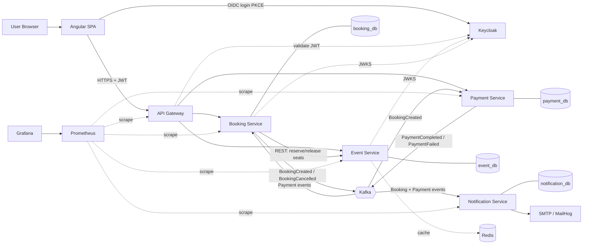
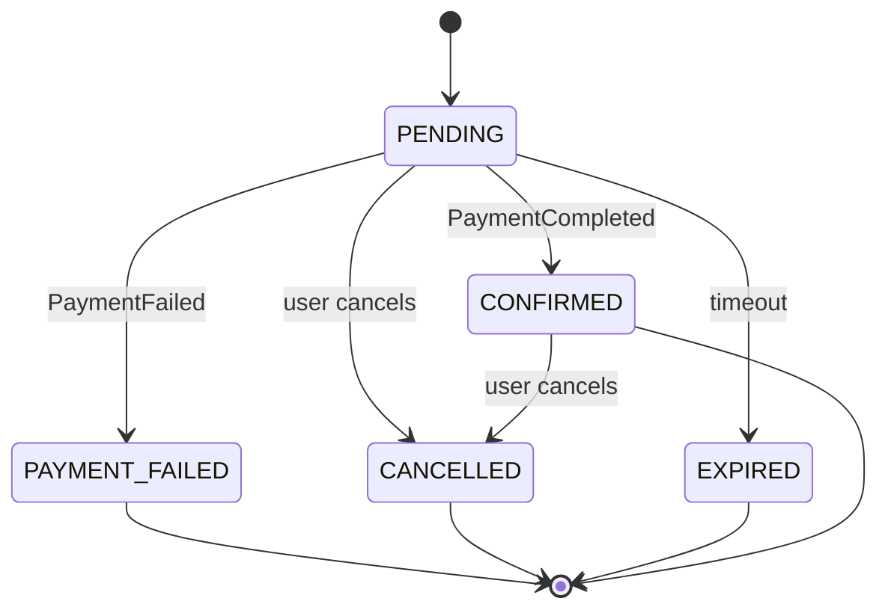
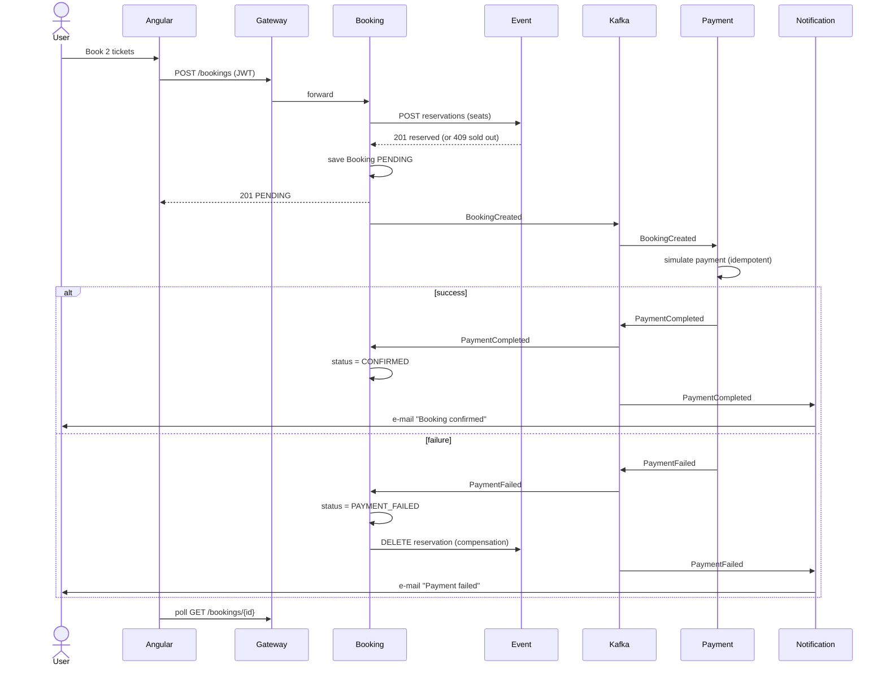

# EventHub - Implementation Plan

> Educational microservices project: event management and ticket booking platform.
> Goal: hands-on mastery of the modern Java ecosystem and preparation for Java / Fullstack interviews.
> Legend: **[CORE]** = required baseline, **[ADV]** = advanced extension (do after the core works).

## Table of Contents
1. [Project description and goal](#1-project-description-and-goal)
2. [Functional requirements](#2-functional-requirements)
3. [Non-functional requirements](#3-non-functional-requirements)
4. [Tech stack and rationale](#4-tech-stack-and-rationale)
5. [System architecture](#5-system-architecture)
6. [Architecture diagram](#6-architecture-diagram-mermaid)
7. [Microservices description](#7-microservices-description)
8. [Repository structure](#8-repository-structure-monorepo)
9. [Data model and data ownership](#9-data-model-and-data-ownership)
10. [API endpoints](#10-api-endpoints)
11. [REST and Kafka communication](#11-rest-and-kafka-communication)
12. [Booking and payment flow](#12-booking-and-payment-flow)
13. [Keycloak integration](#13-keycloak-integration)
14. [Error handling strategy](#14-error-handling-strategy)
15. [Testing strategy](#15-testing-strategy)
16. [Docker and Docker Compose](#16-docker-and-docker-compose)
17. [Kubernetes](#17-kubernetes)
18. [CI/CD with GitHub Actions](#18-cicd-with-github-actions)
19. [Monitoring and logging](#19-monitoring-and-logging)
20. [Security](#20-security)
21. [Implementation roadmap](#21-implementation-roadmap)
22. [Interview topics](#22-interview-topics-linked-to-the-project)
23. [Definition of Done](#23-definition-of-done)

---

## 1. Project description and goal

EventHub lets users browse events, book and cancel tickets, and pay (simulated). Organizers create and manage events. Admins manage the whole system. E-mail notifications are sent on booking confirmation or cancellation.

**Learning goals**
- Design and split a system into microservices with *database per service*.
- Combine sync (REST) and async (Kafka) communication; understand trade-offs.
- Secure a SPA + APIs with OAuth2 / OIDC via Keycloak.
- Containerize, deploy to Kubernetes, automate CI/CD, observe with Prometheus/Grafana.
- Be able to explain every decision in an interview, including alternatives and pitfalls.

**Scope principle:** ambitious but doable by one person. Build a vertical slice first (Event Service + Angular), then add services one by one. Advanced patterns are explicit extensions.

## 2. Functional requirements

### Users and authentication
- [ ] FR-1 Register and log in (via Keycloak).
- [ ] FR-2 View own profile (data from JWT).
- [ ] FR-3 Roles: USER, ORGANIZER, ADMIN.

### Events
- [ ] FR-4 Anyone can browse and search events (pagination, filters by date, city, category).
- [ ] FR-5 ORGANIZER creates, edits, publishes, cancels own events.
- [ ] FR-6 ORGANIZER/ADMIN deletes events (soft delete preferred; forbidden if active bookings exist).
- [ ] FR-7 Event has capacity; available seats are tracked.

### Bookings
- [ ] FR-8 USER books N tickets for an event (status PENDING).
- [ ] FR-9 USER views own bookings and their status.
- [ ] FR-10 USER cancels own booking (seats released).
- [ ] FR-11 Booking states: `PENDING -> CONFIRMED | PAYMENT_FAILED | CANCELLED | EXPIRED`.

### Payments (simulated)
- [ ] FR-12 Payment is simulated (configurable success rate, deterministic mode for tests).
- [ ] FR-13 Success -> booking CONFIRMED; failure -> booking PAYMENT_FAILED and seats released.

### Notifications
- [ ] FR-14 E-mail on booking confirmed, payment failed, booking cancelled (MailHog in dev).

### Administration
- [ ] FR-15 ADMIN lists/blocks users (via Keycloak admin API **[ADV]**), lists all events/bookings, cancels any event.

## 3. Non-functional requirements

| Category | Requirement |
|---|---|
| Scalability | Services stateless, horizontally scalable; Kafka consumer groups |
| Availability | Gateway and services expose health probes; graceful shutdown |
| Consistency | Eventual consistency between services; strong consistency inside a service |
| Performance | Event list p95 < 300 ms locally; Redis cache for hot reads |
| Security | OAuth2/OIDC, JWT validation in each service, least privilege, no secrets in git |
| Observability | Metrics, structured logs, correlation/trace IDs |
| Maintainability | Layered/hexagonal-lite structure, >=80% coverage on domain/service layers |
| Portability | 12-factor config via env variables; runs with one `docker compose up` |
| Testability | Testcontainers for DB/Kafka; no tests depend on external internet |
| Documentation | OpenAPI per service, ADRs, README with architecture |

## 4. Tech stack and rationale

| Technology | Why used / problem solved | Alternatives | Common pitfalls |
|---|---|---|---|
| Java 21 LTS | Records, pattern matching, virtual threads, long-term support | Kotlin, Java 17 | Misusing virtual threads with `synchronized`/pinning |
| Spring Boot 3.x | Convention over configuration, production-ready | Quarkus, Micronaut | Hidden auto-config magic; fat controllers |
| Spring Data JPA | Reduces boilerplate persistence | jOOQ, JDBC Template, MyBatis | N+1 queries, `EAGER` fetch, entities in API |
| Spring Security | Standard security framework, resource server support | Shiro | Misconfigured filter chain, disabling CSRF blindly |
| Spring Cloud Gateway | Routing, filters, single entry point | Nginx, Kong, Traefik | Business logic in gateway; gateway as SPOF |
| Bean Validation | Declarative input validation (fail fast) | Manual checks | Validating only on frontend |
| Actuator + Micrometer | Health, metrics | custom endpoints | Exposing all endpoints publicly |
| MapStruct | Compile-time DTO mapping, no reflection | ModelMapper, manual | Mapping lazy collections; forgetting null handling |
| Lombok (limited) | Less boilerplate for builders/getters | Records, IDE generation | `@Data` on JPA entities (equals/hashCode, toString loops). Use only `@Slf4j`, `@RequiredArgsConstructor`, `@Builder`, `@Getter` |
| Flyway | Versioned DB migrations | Liquibase | Editing applied migrations; `ddl-auto=update` in prod |
| PostgreSQL | Reliable relational DB | MySQL | Missing indexes, long transactions |
| Apache Kafka | Durable event log, decoupling, replay | RabbitMQ, ActiveMQ | Assuming exactly-once; poison messages; wrong partition keys |
| Redis | Cache, optional idempotency/rate limit store | Caffeine, Hazelcast | Stale cache, no TTL, cache as source of truth |
| Keycloak | Ready IdP: OIDC, roles, user management | Auth0, Okta, own auth | Putting roles in wrong token claims; long-lived tokens |
| Angular + Material | Structured SPA framework, RxJS, DI | React, Vue | Subscriptions leaks, logic in components |
| Testcontainers | Real dependencies in tests | H2, embedded Kafka | H2 dialect differences; slow tests if not reusing containers |
| Docker / Compose | Reproducible environments | Podman | Fat images, running as root |
| Kubernetes (+Helm optional) | Orchestration, scaling, self-healing | Docker Swarm, Nomad | Missing probes/limits; secrets in ConfigMaps |
| GitHub Actions | CI/CD close to repo | GitLab CI, Jenkins | Unpinned actions, secrets exposure |
| Prometheus + Grafana | Metrics + dashboards | ELK, Datadog | High-cardinality labels |
| springdoc-openapi | OpenAPI docs from code | Manual YAML | Docs out of sync with behavior |

**Build tool:** Maven multi-module (parent POM for dependency management) - recommended for interview familiarity. Gradle is an acceptable alternative.

## 5. System architecture

- **Style:** microservices, event-driven, API-gateway pattern.
- **Database per service:** one PostgreSQL instance (dev) with separate databases/schemas and separate users per service (`event_db`, `booking_db`, `payment_db`, `notification_db`). In K8s may be separate instances.
- **No shared JPA entities.** Services share only *contracts* (event JSON schemas / OpenAPI), documented in `docs/contracts` - optionally a small `shared-events` module with plain records **[ADV, debatable]**; default is duplicating DTOs to keep loose coupling.
- **Sync:** REST via Gateway (client -> services); service-to-service REST (Booking -> Event) with timeouts, retries, circuit breaker (Resilience4j).
- **Async:** Kafka topics for booking/payment lifecycle events.
- **Saga:** choreography-based (no central orchestrator) for the booking process; compensation = release seats, mark booking failed.
- **Design principles applied:** Clean Code, SOLID, SoC, DRY, DI, REST best practices, basic DDD (entities, value objects, aggregates, domain events, repositories, bounded contexts), Loose Coupling/High Cohesion, Fail Fast, Twelve-Factor.

**Internal service layout (all services):** `api` (controllers, DTOs) -> `application` (use-case services, transactions) -> `domain` (entities, value objects, domain events, rules) -> `infrastructure` (JPA repos, Kafka, REST clients, config).

## 6. Architecture diagram (Mermaid)



## 7. Microservices description

### 7.1 API Gateway (`api-gateway`, port 8080)
- Spring Cloud Gateway (reactive). Routes `/api/events/**`, `/api/bookings/**`, `/api/payments/**`.
- Validates JWT (resource server), CORS config for Angular, rate limiting with Redis **[ADV]**, correlation ID filter.
- No business logic. Services still validate JWT themselves (defense in depth).
- *Interview:* gateway vs. load balancer vs. reverse proxy; BFF pattern.

### 7.2 Event Service (`event-service`, port 8081)
- Aggregate: `Event` (with `Venue` value object, `Money` price). Manages `availableSeats`.
- Operations: CRUD, publish, cancel, search, seat reservation/release (idempotent by `bookingId`).
- Seat reservation uses optimistic locking (`@Version`) or atomic SQL `UPDATE ... WHERE available_seats >= :n`.
- Redis cache for event details/list (evicted on update).

### 7.3 Booking Service (`booking-service`, port 8082)
- Aggregate: `Booking` with state machine.
- Create booking: validate event via REST, reserve seats (sync call), save PENDING, publish `BookingCreated`.
- Reacts to payment events (updates status), expires stale PENDING bookings (scheduled job).
- Cancel: allowed for owner in PENDING/CONFIRMED; publishes `BookingCancelled`.

### 7.4 Payment Service (`payment-service`, port 8083)
- Consumes `BookingCreated`, simulates payment (random/configurable delay & outcome), stores `Payment`.
- Publishes `PaymentCompleted` / `PaymentFailed`. Idempotent per `bookingId`.
- Optional refund simulation on `BookingCancelled` **[ADV]**.

### 7.5 Notification Service (`notification-service`, port 8084)
- Consumes booking + payment events, renders e-mail templates (Thymeleaf), sends via SMTP (MailHog).
- Stores sent-notification log; dedup by `eventId`.
- No public API except admin read endpoint **[optional]**.

### 7.6 Keycloak (port 8180 in dev)
- Realm `eventhub`, imported from `infra/keycloak/eventhub-realm.json`.

### 7.7 Frontend (`frontend`, Angular, port 4200)
- Feature modules/standalone components: `events`, `bookings`, `organizer`, `admin`, `auth`, shared layout.

## 8. Repository structure (monorepo)

```
eventhub/
├── plan.md
├── README.md
├── pom.xml                      # parent POM (dependencyManagement, plugins, Java 21)
├── docs/
│   ├── adr/                     # Architecture Decision Records
│   ├── contracts/               # Kafka event schemas, sequence diagrams
│   └── interview/               # Q&A notes
├── services/
│   ├── api-gateway/
│   ├── event-service/
│   │   ├── pom.xml
│   │   ├── Dockerfile
│   │   └── src/
│   │       ├── main/java/dev/eventhub/event/
│   │       │   ├── api/             # controllers, request/response DTOs, exception handler
│   │       │   ├── application/     # services / use cases
│   │       │   ├── domain/          # entities, value objects, domain events
│   │       │   ├── infrastructure/  # repositories, cache, security config
│   │       │   └── EventServiceApplication.java
│   │       ├── main/resources/{application.yml, db/migration/V1__init.sql}
│   │       └── test/java/...
│   ├── booking-service/
│   ├── payment-service/
│   └── notification-service/
├── frontend/                    # Angular app
│   └── src/app/{core,shared,features/{events,bookings,organizer,admin}}
├── infra/
│   ├── docker/                  # compose files, env templates
│   ├── keycloak/                # realm export
│   ├── k8s/                     # manifests (kustomize base/overlays)
│   ├── helm/                    # optional chart
│   ├── prometheus/prometheus.yml
│   └── grafana/{dashboards,provisioning}
└── .github/workflows/           # ci-*.yml, cd.yml
```

## 9. Data model and data ownership

| Service | Owns | Does NOT own |
|---|---|---|
| Event | events, venues, seat reservations ledger | bookings, payments |
| Booking | bookings, processed_events, outbox | event details (keeps snapshot: title, price) |
| Payment | payments, processed_events, outbox | bookings |
| Notification | notifications, processed_events | everything else |
| Keycloak | users, credentials, roles | business data |

Cross-service references are plain IDs (UUID), never foreign keys. Data needed later is copied (snapshot) into the event payload.

### Event Service
```
events(id UUID PK, organizer_id VARCHAR, title, description, category, city, venue_name,
       starts_at TIMESTAMPTZ, ends_at, price_amount NUMERIC(10,2), currency CHAR(3),
       capacity INT, available_seats INT CHECK (available_seats >= 0),
       status ENUM[DRAFT,PUBLISHED,CANCELLED], version BIGINT, created_at, updated_at)
seat_reservations(booking_id UUID PK, event_id UUID FK, seats INT, status[RESERVED,RELEASED], created_at)
```
`seat_reservations` makes reserve/release idempotent by `booking_id`.

### Booking Service
```
bookings(id UUID PK, user_id VARCHAR, event_id UUID, event_title, quantity INT,
         unit_price NUMERIC, total_amount NUMERIC, currency, status ENUM, failure_reason,
         created_at, updated_at, expires_at, version BIGINT)
processed_events(event_id UUID PK, processed_at)
outbox_events(id, aggregate_id, type, payload JSONB, created_at, published_at)   -- [ADV]
```

### Payment Service
```
payments(id UUID PK, booking_id UUID UNIQUE, user_id, amount, currency,
         status ENUM[COMPLETED,FAILED], failure_reason, created_at)
processed_events(event_id UUID PK, processed_at)
```

### Notification Service
```
notifications(id UUID PK, booking_id, recipient_email, type, status[SENT,FAILED], error, created_at)
processed_events(event_id UUID PK, processed_at)
```

Booking status state machine:


## 10. API endpoints

All under `/api`, versioned by path `/api/v1` **[recommended]**. Errors use RFC 7807 Problem Details.

### Event Service
| Method | Path | Role | Description |
|---|---|---|---|
| GET | `/api/v1/events?city=&category=&from=&to=&page=0&size=20&sort=startsAt,asc` | public | List published events |
| GET | `/api/v1/events/{id}` | public | Event details |
| POST | `/api/v1/events` | ORGANIZER | Create (DRAFT) |
| PUT | `/api/v1/events/{id}` | ORGANIZER (owner), ADMIN | Update |
| POST | `/api/v1/events/{id}/publish` | ORGANIZER (owner) | Publish |
| POST | `/api/v1/events/{id}/cancel` | ORGANIZER (owner), ADMIN | Cancel event |
| DELETE | `/api/v1/events/{id}` | ORGANIZER (owner), ADMIN | Delete (soft) |
| GET | `/api/v1/organizer/events` | ORGANIZER | Own events |
| POST | `/internal/v1/events/{id}/reservations` | service-to-service | Reserve seats `{bookingId, seats}` |
| DELETE | `/internal/v1/events/{id}/reservations/{bookingId}` | service-to-service | Release seats |

`/internal/**` is not routed by the gateway; protected by a service account (client credentials) with a dedicated role.

### Booking Service
| Method | Path | Role | Description |
|---|---|---|---|
| POST | `/api/v1/bookings` | USER | Create booking `{eventId, quantity}` + `Idempotency-Key` header |
| GET | `/api/v1/bookings/{id}` | owner, ADMIN | Status |
| GET | `/api/v1/bookings/me` | USER | Own bookings |
| POST | `/api/v1/bookings/{id}/cancel` | owner | Cancel |
| GET | `/api/v1/admin/bookings` | ADMIN | All bookings |

### Payment Service
| Method | Path | Role | Description |
|---|---|---|---|
| GET | `/api/v1/payments/booking/{bookingId}` | owner, ADMIN | Payment status |
| GET | `/api/v1/admin/payments` | ADMIN | List payments |

### Notification Service
| Method | Path | Role | Description |
|---|---|---|---|
| GET | `/api/v1/admin/notifications` | ADMIN | Sent notifications log |

### Common
`/actuator/health`, `/actuator/prometheus` (internal only), `/v3/api-docs`, `/swagger-ui.html` (dev only).

Example request/response:
```http
POST /api/v1/bookings
Authorization: Bearer <jwt>
Idempotency-Key: 6f1c...
{ "eventId": "b1c2...", "quantity": 2 }

201 Created
Location: /api/v1/bookings/9a7d...
{ "id": "9a7d...", "status": "PENDING", "totalAmount": 120.00, "currency": "PLN" }
```

## 11. REST and Kafka communication

### REST (sync)
- Frontend -> Gateway -> services.
- Booking -> Event via `RestClient` (or Spring HTTP interface) with: connect/read timeouts, Resilience4j retry (idempotent calls only), circuit breaker, fallback = fail fast with 503.
- OpenAPI generated by springdoc; optionally generate Angular client from the spec **[ADV]**.

### Kafka (async)
| Topic | Key | Producer | Consumers |
|---|---|---|---|
| `booking.created.v1` | bookingId | Booking | Payment, Notification |
| `booking.cancelled.v1` | bookingId | Booking | Payment (refund), Notification |
| `payment.completed.v1` | bookingId | Payment | Booking, Notification |
| `payment.failed.v1` | bookingId | Payment | Booking, Notification |
| `*.dlt` | same | error handler | manual inspection / replay |

- Key = `bookingId` -> ordering per booking within a partition.
- Event envelope:
```json
{ "eventId": "uuid", "type": "PaymentCompleted", "occurredAt": "2026-01-01T10:00:00Z",
  "version": 1, "correlationId": "uuid",
  "payload": { "bookingId": "uuid", "userId": "...", "userEmail": "...", "amount": 120.00, "currency": "PLN" } }
```
- JSON serialization (JsonSerializer with type mapping) first; Avro + Schema Registry **[ADV]**.
- Consumer config: manual/`RECORD` ack after successful DB commit, `enable.auto.commit=false`, `auto.offset.reset=earliest`.
- Producer config: `acks=all`, `enable.idempotence=true`.
- **Delivery semantics:** at-least-once + idempotent consumers = effectively-once.

## 12. Booking and payment flow



**Saga type:** choreography. Compensating action: release seats on payment failure/expiry/cancel.

**Eventual consistency:** between `PENDING` creation and final status the UI polls (later SSE/WebSocket **[ADV]**).

**Reliability mechanisms**
- **Idempotency:** `processed_events` table (insert eventId in same transaction as state change; unique violation = duplicate, skip). HTTP `Idempotency-Key` for POST booking. Reserve/release keyed by `bookingId`.
- **Retry:** Spring Kafka `DefaultErrorHandler` / `@RetryableTopic` with exponential backoff (e.g., 3 attempts: 1s, 2s, 4s).
- **DLQ:** after retries exhausted -> `<topic>.dlt` (`DeadLetterPublishingRecoverer`). Non-retryable exceptions (deserialization, validation) go to DLT immediately.
- **Duplicates:** see idempotency; also consumer rebalancing can redeliver.
- **Outbox Pattern [ADV]:** problem: DB commit and Kafka publish are not atomic (dual write). Solution: write event to `outbox_events` in the same transaction; a poller (or Debezium CDC) publishes and marks as published.
- **Expiration:** scheduled job marks PENDING bookings older than N minutes as EXPIRED and releases seats (use ShedLock when scaled **[ADV]**).

## 13. Keycloak integration

### Authentication vs authorization
- **Authentication** = who are you (login, token issued by Keycloak, identity proven by OIDC ID token).
- **Authorization** = what may you do (roles/scopes in access token, checked by services via `@PreAuthorize` and ownership checks).

### Realm `eventhub`
- Realm roles: `USER` (default role for new users), `ORGANIZER`, `ADMIN`.
- Self-registration enabled, e-mail as username, email verification optional in dev.
- Access token lifespan 5 min, refresh token 30 min, SSO session reasonable values.
- Test users: `user1/user1`, `organizer1/organizer1`, `admin1/admin1` (dev only).
- Realm exported to JSON and imported on container start (`--import-realm`).

### Clients
| Client | Type | Flow | Purpose |
|---|---|---|---|
| `eventhub-frontend` | public | Authorization Code + PKCE | Angular SPA; strict redirect URIs and web origins |
| `eventhub-gateway` | bearer-only / resource | - | Validates tokens (audience) |
| `eventhub-booking-service` | confidential | Client Credentials | Service-to-service calls (Booking -> Event) |
| `eventhub-services` (audience mapper) | - | - | Adds `aud=eventhub-api` to access tokens |

### Angular
- Library: `angular-oauth2-oidc` (lighter, good for learning) or `keycloak-js` / `keycloak-angular`.
- `AuthService` wraps login/logout/token/roles; init in `APP_INITIALIZER`.
- `AuthInterceptor` attaches `Authorization: Bearer` to calls to the gateway only.
- `authGuard` (logged in) and `roleGuard` (route `data: { roles: ['ORGANIZER'] }`) as functional guards.
- Hide UI elements by role, **but never rely on it** - backend enforces.
- Silent refresh / refresh token handling; logout redirect.

### Spring Security (each service + gateway)
- `spring-boot-starter-oauth2-resource-server`, `issuer-uri` -> JWKS auto-discovery, signature/expiry/issuer/audience validation.
- Custom `JwtAuthenticationConverter` mapping `realm_access.roles` -> `ROLE_USER`, `ROLE_ORGANIZER`, `ROLE_ADMIN`.
- Stateless sessions, CSRF disabled (bearer tokens, no cookies), CORS configured explicitly.
- Endpoint rules: `GET /events/**` permitAll; `@PreAuthorize("hasRole('ORGANIZER')")` on write; ownership check `event.organizerId == jwt.sub` in service layer (method security with SpEL or domain check).
- Current user: `@AuthenticationPrincipal Jwt jwt` -> `sub`, `email`, `preferred_username`.
- Tests: `spring-security-test` with `jwt()` post-processor; integration tests with Keycloak Testcontainer **[ADV]**.

## 14. Error handling strategy

- **Fail fast:** validate input with Bean Validation at the API boundary; domain invariants enforced in constructors/aggregate methods.
- **Uniform errors:** `@RestControllerAdvice` returns RFC 7807 `ProblemDetail` with `type`, `title`, `status`, `detail`, `traceId`, field errors.
- **Exception mapping:** `NotFound` 404, `ValidationException` 400, `Conflict/SoldOut/OptimisticLock` 409, `Unauthorized` 401, `Forbidden` 403, downstream failure 502/503, unexpected 500 (no stack traces to clients).
- **Inter-service calls:** timeouts, retry (idempotent only), circuit breaker, bulkhead **[ADV]**.
- **Kafka:** retry with backoff -> DLT; alert on DLT growth; replay tool/endpoint **[ADV]**.
- **Frontend:** global `ErrorInterceptor` (401 -> login, 403 -> forbidden page, 5xx -> toast), form-level server validation errors.
- **Antipatterns:** swallowing exceptions, catching `Exception` broadly, using exceptions for control flow, returning 200 with error body, leaking internals.

## 15. Testing strategy

| Level | Tools | Scope |
|---|---|---|
| Unit | JUnit 5, Mockito, AssertJ | Domain logic, services, mappers, state machine |
| Slice | `@WebMvcTest`, `@DataJpaTest` (with Testcontainers Postgres) | Controllers + security rules, repositories |
| Integration | `@SpringBootTest`, Testcontainers (Postgres, Kafka, Redis, Keycloak optional) | Service end-to-end incl. Kafka consumers, Flyway migrations |
| Contract | Spring Cloud Contract / Pact **[ADV]** | Booking <-> Event, Kafka payloads |
| E2E | Docker Compose + Playwright/Cypress **[ADV]** | Happy path booking |
| Frontend unit | Jasmine/Karma or Jest, Angular `TestBed`, `HttpTestingController` | Components, services, guards, interceptors |
| Architecture | ArchUnit **[ADV]** | Layer rules, no cross-service deps |
| Performance | k6 / Gatling **[ADV]** | Booking under load, seat oversell check |

Rules: test pyramid; AAA/Given-When-Then; no sleeps (use Awaitility); name tests by behavior; JaCoCo coverage gate; reuse containers (`@ServiceConnection`, singleton containers).

Key scenarios: concurrent booking of last seats (no overselling), duplicate Kafka message, payment failure compensation, unauthorized access, expired token.

## 16. Docker and Docker Compose

- Multi-stage Dockerfiles (Maven build -> `eclipse-temurin:21-jre`), non-root user, layered jars / Spring Boot buildpacks (`spring-boot:build-image`) as alternative; `.dockerignore`.
- Frontend: build with Node, serve via nginx with SPA fallback and runtime config.
- `infra/docker/docker-compose.yml` profiles:
  - `infra` - postgres, kafka (KRaft, no Zookeeper), redis, keycloak, mailhog, kafka-ui.
  - `apps` - all services + frontend.
  - `observability` - prometheus, grafana (+ Loki/Tempo **[ADV]**).
- Postgres init script creates multiple databases/users.
- Healthchecks + `depends_on: condition: service_healthy`.
- Config via `.env` (`.env.example` committed, `.env` ignored).
- Dev workflow: `docker compose --profile infra up -d`, run services from IDE; full stack with `--profile apps`.

## 17. Kubernetes

- Local cluster: kind or minikube. Namespace `eventhub`.
- Per service: `Deployment` (replicas, resources requests/limits, liveness/readiness/startup probes via Actuator), `Service`, `ConfigMap`, `Secret`, `HorizontalPodAutoscaler` **[ADV]**.
- `Ingress` (nginx-ingress) exposing frontend and gateway.
- Stateful components: Postgres/Kafka/Keycloak via `StatefulSet` or community Helm charts (Bitnami/Strimzi) - do not hand-roll for production.
- Config structure: Kustomize `base/` + `overlays/{dev,prod}`; Helm chart **[ADV, optional]**.
- Practice: rolling update, rollback, scaling, pod failure, `kubectl logs/describe/port-forward`.
- Security: `NetworkPolicy` **[ADV]**, non-root, read-only FS, no secrets in git (Sealed Secrets/External Secrets **[ADV]**).

## 18. CI/CD with GitHub Actions

- `ci-backend.yml` (matrix per service, path filters): checkout -> setup-java 21 + Maven cache -> `mvn verify` (unit + Testcontainers) -> JaCoCo report -> upload artifacts.
- `ci-frontend.yml`: Node cache -> `npm ci` -> lint -> test (headless) -> build.
- `docker.yml`: build and push images to GHCR on `main`/tags (tags: git SHA + semver); Buildx cache.
- `security.yml`: Dependabot, CodeQL, Trivy image scan **[ADV]**.
- `cd.yml`: deploy to kind in the pipeline for smoke test, or manual `workflow_dispatch` to a cluster **[ADV]**.
- Branch protection: PR required, CI green, conventional commits.
- Secrets via GitHub Secrets / OIDC; pin action versions.

## 19. Monitoring and logging

- **Metrics:** Actuator + Micrometer -> `/actuator/prometheus`; JVM, HTTP, Hikari, Kafka consumer lag; custom metrics (`bookings_created_total`, `payments_failed_total`).
- **Prometheus:** scrape config per service; alert rules (error rate, consumer lag, DLT size) **[ADV]**.
- **Grafana:** provisioned dashboards: JVM (Micrometer), service RED metrics (Rate/Errors/Duration), business dashboard.
- **Logging:** JSON structured logs (Logback + logstash encoder), MDC with `traceId`, `correlationId`, `userId` (no PII/secrets); central aggregation with Loki **[ADV]**.
- **Tracing [ADV]:** Micrometer Tracing + OpenTelemetry -> Tempo/Jaeger; trace propagation over HTTP and Kafka headers.
- **Health:** liveness vs readiness groups.

## 20. Security

- OWASP Top 10 awareness: broken access control (ownership checks - IDOR), injection (parameterized queries), security misconfiguration, vulnerable components (Dependabot).
- HTTPS everywhere outside local dev; HSTS and security headers at ingress/nginx.
- CORS: explicit origins only.
- Secrets in env/Secret store; never in repo or images.
- Validation + output encoding; limit payload sizes; pagination caps.
- Rate limiting at gateway **[ADV]**.
- Principle of least privilege: DB users per service, Keycloak roles minimal, service accounts scoped.
- Audit log for admin actions **[ADV]**.
- Token handling in SPA: in-memory tokens + PKCE; discuss XSS vs cookie tradeoffs; BFF pattern as alternative **[ADV]**.
- Kafka: ACL/SASL **[ADV]** (note plaintext in dev).

## 21. Implementation roadmap

Each stage: Goal, Tasks, Order, Tech, Result, Acceptance, Study topics, Tests. Do stages in order; mark `[x]` when done.

### Stage 1 - Repository and project foundations
- **Goal:** clean monorepo, conventions and build skeleton.
- **Tasks / order:**
  - [x] Init git repo, `.gitignore`, `.editorconfig`, `README.md`, `LICENSE`.
  - [x] Parent Maven POM (Java 21, Spring Boot BOM, plugins: compiler, surefire, failsafe, jacoco, spotless/checkstyle).
  - [x] Create `services/event-service` skeleton (Spring Initializr: Web, JPA, Validation, Actuator, Flyway, Postgres, Lombok, MapStruct).
  - [x] Folder structure from section 8, `docs/adr/0001-monorepo.md`.
  - [x] Conventional commits + branching rules documented.
  - [x] Minimal `docker-compose.yml` with Postgres.
- **Tech:** Maven, Git, Spring Initializr, Docker.
- **Result:** `mvn verify` passes; app starts and `/actuator/health` is UP.
- **Acceptance:** [x] fresh clone builds with a single command; [x] README explains how to run.
- **Study:** Maven lifecycle and dependency management, BOM, Spring Boot auto-configuration, Twelve-Factor config, profiles.
- **Tests:** context-loads smoke test.

### Stage 2 - Event Service and CRUD
- **Goal:** complete, well-structured Event Service (no security yet).
- **Tasks / order:**
  - [ ] Flyway `V1__create_events.sql`.
  - [ ] Entity, enum, value objects; repository.
  - [ ] DTOs (records) + MapStruct mappers.
  - [ ] Service layer with transactions; domain rules (cannot reduce capacity below sold).
  - [ ] REST controller: CRUD, publish, cancel, search with `Pageable` + `Specification`/query.
  - [ ] Bean Validation + `@RestControllerAdvice` with ProblemDetail.
  - [ ] springdoc OpenAPI.
  - [ ] Seat reservation endpoints (internal) with idempotency.
  - [ ] Redis cache for GET (optional, can postpone to Stage 12).
- **Tech:** Spring Web/Data JPA, Flyway, MapStruct, Validation.
- **Result:** documented CRUD API working with Postgres.
- **Acceptance:** [ ] all endpoints in section 10 (event part) work; [ ] validation errors return 400 Problem Details; [ ] migrations create schema from scratch; [ ] pagination works.
- **Study:** REST maturity/idempotent methods, status codes, JPA lifecycle, N+1, LAZY/EAGER, `@Transactional` propagation, DTO vs entity, optimistic vs pessimistic locking, Flyway vs Liquibase.
- **Tests:** unit (service, mapper), `@WebMvcTest` controller, `@DataJpaTest` with Testcontainers, concurrency test for seat reservation.

### Stage 3 - Angular and basic frontend
- **Goal:** SPA consuming Event API.
- **Tasks / order:**
  - [ ] `ng new` (standalone components, routing, SCSS), Angular Material theme.
  - [ ] Structure `core/shared/features`; environment config.
  - [ ] Event list (pagination, filters), event details.
  - [ ] Organizer: create/edit event with Reactive Forms and validators.
  - [ ] `EventService` using `HttpClient`, typed models, RxJS operators (`switchMap`, `debounceTime`, `catchError`).
  - [ ] Global error interceptor + loading indicator.
  - [ ] Routing with lazy-loaded features.
- **Tech:** Angular, TypeScript, RxJS, Material.
- **Result:** browse/create/edit events in UI (CORS enabled in dev).
- **Acceptance:** [ ] list/detail/form work; [ ] form validation messages; [ ] lazy routes; [ ] no unsubscribed leaks (`async` pipe / `takeUntilDestroyed`).
- **Study:** change detection (OnPush), signals vs RxJS, Observables vs Promises, cold/hot, DI hierarchy, smart vs dumb components, template-driven vs reactive forms.
- **Tests:** component tests with `TestBed`, service tests with `HttpTestingController`, form validator tests.

### Stage 4 - Docker and Docker Compose
- **Goal:** one-command local environment.
- **Tasks:**
  - [ ] Dockerfile for event-service (multi-stage, non-root).
  - [ ] Dockerfile + nginx conf for frontend.
  - [ ] Compose with profiles `infra`/`apps`, healthchecks, `.env.example`.
  - [ ] Postgres init script for multiple DBs.
  - [ ] Spring profile `docker`.
- **Tech:** Docker, Compose, nginx.
- **Result:** `docker compose --profile apps up` runs frontend + event-service + Postgres.
- **Acceptance:** [ ] images < ~300 MB; [ ] services wait for healthy DB; [ ] no secrets baked in.
- **Study:** image layers/cache, multi-stage builds, volumes vs bind mounts, networks, `CMD` vs `ENTRYPOINT`, container memory and JVM (`-XX:MaxRAMPercentage`).
- **Tests:** smoke test script (curl health + list events).

### Stage 5 - Keycloak and Spring Security
- **Goal:** authentication and RBAC across frontend and Event Service.
- **Tasks / order:**
  - [ ] Add Keycloak to compose, create realm `eventhub`, roles, clients, test users; export realm JSON.
  - [ ] Spring resource server config, JWT converter for roles, method security.
  - [ ] Ownership checks for organizer actions.
  - [ ] Angular OIDC login (Authorization Code + PKCE), `AuthService`, `AuthInterceptor`, `authGuard`, `roleGuard`.
  - [ ] UI adapts to roles (menu, buttons).
  - [ ] Document token flow in `docs/adr/` with sequence diagram.
- **Tech:** Keycloak, OAuth2/OIDC, JWT, Spring Security, angular-oauth2-oidc.
- **Result:** only logged-in ORGANIZER can create events; GET is public.
- **Acceptance:** [ ] 401 without token; [ ] 403 wrong role; [ ] organizer cannot edit others' events; [ ] guarded routes redirect to login; [ ] realm imports automatically.
- **Study:** OAuth2 grant types, why PKCE, OIDC vs OAuth2, JWT structure/signature (JWKS), access vs ID vs refresh token, scopes vs roles, CORS vs CSRF, stateless auth, IDOR.
- **Tests:** `@WebMvcTest` with `jwt()`; security matrix test (role x endpoint); Angular guard/interceptor tests.

### Stage 6 - Booking Service
- **Goal:** bookings with synchronous seat reservation.
- **Tasks / order:**
  - [ ] Skeleton, DB `booking_db`, Flyway migrations.
  - [ ] `Booking` aggregate with state machine & invariants.
  - [ ] `EventClient` (RestClient) using client-credentials token, timeouts, Resilience4j retry + circuit breaker.
  - [ ] Create / get / list-mine / cancel endpoints; `Idempotency-Key` support.
  - [ ] Security (USER role, owner checks).
  - [ ] Angular: booking form, "my bookings" page with status polling.
  - [ ] Expiration scheduled job.
- **Tech:** Spring Web/JPA, RestClient, Resilience4j, Flyway.
- **Result:** user books tickets; seats decrease; booking stays PENDING (no payment yet; temporary manual/auto confirmation endpoint for dev only).
- **Acceptance:** [ ] sold out -> 409; [ ] cancel releases seats; [ ] Event Service down -> 503 without corrupted data; [ ] duplicate POST with same key returns the same booking.
- **Study:** DDD aggregates/invariants, state pattern, distributed transaction problem, idempotent APIs, circuit breaker states, timeouts, retry storms.
- **Tests:** unit state machine; WireMock/MockRestServiceServer for Event client; integration with Testcontainers; failure scenarios.

### Stage 7 - API Gateway
- **Goal:** single entry point.
- **Tasks:**
  - [ ] Spring Cloud Gateway project; routes (path predicates, `StripPrefix`), block `/internal/**`.
  - [ ] JWT validation, CORS centralization, correlation-ID filter, request logging.
  - [ ] Switch Angular base URL to gateway.
  - [ ] Add gateway to Compose; services no longer exposed publicly.
  - [ ] Aggregated Swagger UI **[ADV]**; Redis rate limiter **[ADV]**.
- **Tech:** Spring Cloud Gateway (WebFlux), Spring Security.
- **Result:** frontend talks only to gateway.
- **Acceptance:** [ ] routing works for all services; [ ] unauthenticated write -> 401 at gateway; [ ] internal endpoints not reachable externally.
- **Study:** reverse proxy vs gateway vs LB, reactive (WebFlux/Reactor) basics, filters (global/route), BFF, service discovery vs static routes (K8s DNS).
- **Tests:** `@SpringBootTest` with WireMock backend; route tests; CORS preflight test.

### Stage 8 - Apache Kafka and async communication
- **Goal:** event-driven foundation.
- **Tasks:**
  - [ ] Kafka (KRaft) + Kafka UI in Compose.
  - [ ] Define event contracts in `docs/contracts` and topic naming.
  - [ ] Producer in Booking (`BookingCreated`, `BookingCancelled`).
  - [ ] Consumer skeleton with error handler, retry/backoff, DLT.
  - [ ] `processed_events` idempotency component.
  - [ ] Producer/consumer config (`acks=all`, idempotence, manual commits).
- **Tech:** Spring Kafka, Kafka, Jackson.
- **Result:** Booking publishes events visible in Kafka UI; consumer processes them idempotently.
- **Acceptance:** [ ] duplicates processed once; [ ] poison message lands in DLT; [ ] partition key = bookingId.
- **Study:** topics/partitions/offsets, consumer groups, rebalancing, delivery semantics, ordering guarantees, retention/compaction, Kafka vs RabbitMQ, schema evolution.
- **Tests:** Testcontainers Kafka; produce-consume test; duplicate and poison message tests (Awaitility).

### Stage 9 - Payment Service
- **Goal:** simulated payments and booking status updates.
- **Tasks:**
  - [ ] Skeleton, `payment_db`, migrations.
  - [ ] Consume `BookingCreated` -> simulate (configurable success rate/delay, deterministic rule e.g. amount ending, for tests).
  - [ ] Persist `Payment`; publish `PaymentCompleted`/`PaymentFailed`.
  - [ ] Booking consumes payment events: CONFIRMED / PAYMENT_FAILED + compensation (release seats).
  - [ ] Handle late payment for cancelled/expired booking (ignore or refund).
  - [ ] Remove dev-only manual confirmation endpoint.
- **Tech:** Spring Kafka, JPA.
- **Result:** full saga works end-to-end.
- **Acceptance:** [ ] success path -> CONFIRMED; [ ] failure path -> PAYMENT_FAILED and seats restored; [ ] reprocessing same event changes nothing; [ ] UI shows final status.
- **Study:** saga choreography vs orchestration, compensating transactions, eventual consistency, 2PC drawbacks, out-of-order events.
- **Tests:** unit payment simulator; integration test for full flow with Kafka; race test cancel vs payment.

### Stage 10 - Notification Service
- **Goal:** e-mail on lifecycle events.
- **Tasks:**
  - [ ] Skeleton, `notification_db`; MailHog in Compose.
  - [ ] Consumers for booking/payment events.
  - [ ] Thymeleaf templates; `JavaMailSender`; retry on SMTP failure; DLT.
  - [ ] Store notification log; dedup by `eventId`.
  - [ ] Recipient email comes from event payload (copied from JWT at booking time).
- **Tech:** Spring Kafka, Spring Mail, Thymeleaf.
- **Result:** confirmation/failure/cancel e-mails visible in MailHog.
- **Acceptance:** [ ] one e-mail per event even on redelivery; [ ] SMTP outage does not lose messages (retry then DLT).
- **Study:** consumer idempotency, backoff strategies, async side effects, template rendering, PII handling.
- **Tests:** GreenMail/MailHog container for mail tests; consumer integration tests.

### Stage 11 - Unit and integration tests consolidation
- **Goal:** reliable safety net.
- **Tasks:**
  - [ ] Coverage gate (JaCoCo >= 80% for domain/application).
  - [ ] Shared Testcontainers config (singleton, reuse).
  - [ ] Missing slice/integration tests per service; security matrix tests.
  - [ ] Angular: tests for guards, interceptors, key components; coverage report.
  - [ ] E2E happy path (Playwright/Cypress) **[ADV]**; ArchUnit rules **[ADV]**; contract tests **[ADV]**.
- **Tech:** JUnit 5, Mockito, Testcontainers, Spring Boot Test, Jasmine/Jest.
- **Result:** `mvn verify` and `npm test` green and fast.
- **Acceptance:** [ ] coverage gate passes; [ ] no flaky tests (run 5x); [ ] total backend test time acceptable (<10 min).
- **Study:** test pyramid, mocks vs stubs vs fakes, `@MockBean` vs `@Mock`, test slices, flaky tests, TDD/BDD, mutation testing (PIT) **[ADV]**.
- **Tests:** this stage *is* tests; review for anti-patterns (over-mocking, testing implementation, shared mutable state).

### Stage 12 - Advanced microservice patterns
- **Goal:** harden the system. All items are [ADV]; pick the most valuable.
- **Tasks:**
  - [ ] Outbox Pattern in Booking and Payment (poller + `published_at`; optionally Debezium).
  - [ ] Redis: cache events with TTL/eviction; idempotency keys; rate limiting.
  - [ ] Resilience4j bulkhead / rate limiter; scheduled-job locking (ShedLock).
  - [ ] Distributed tracing (OpenTelemetry).
  - [ ] Avro + Schema Registry or schema versioning strategy.
  - [ ] SSE for live booking status.
- **Tech:** Redis, Resilience4j, OpenTelemetry, Debezium (optional).
- **Result:** no lost events on crash between DB commit and publish.
- **Acceptance:** [ ] kill service between commit and publish -> event still delivered; [ ] cache hit ratio visible in metrics.
- **Study:** dual-write problem, transactional outbox vs CDC, cache-aside/write-through, cache stampede, CQRS and event sourcing (concepts), backpressure.
- **Tests:** chaos-like integration test (fail publisher), cache eviction tests.

### Stage 13 - Kubernetes
- **Goal:** run the system on a local cluster.
- **Tasks:**
  - [ ] kind/minikube setup, namespace, Ingress controller.
  - [ ] Manifests (Kustomize base + dev overlay) for all apps; ConfigMaps/Secrets.
  - [ ] Probes (liveness/readiness/startup), resource requests/limits.
  - [ ] Infra via Helm charts (Postgres, Kafka/Strimzi, Redis) and Keycloak.
  - [ ] HPA for booking-service **[ADV]**; Helm chart for own services **[ADV]**.
- **Tech:** Kubernetes, kubectl, Kustomize, Helm (optional).
- **Result:** full stack reachable via ingress.
- **Acceptance:** [ ] `kubectl apply -k` brings the system up; [ ] killing a pod -> self-heals without lost requests; [ ] rolling update has zero downtime; [ ] rollback tested.
- **Study:** Pod/Deployment/ReplicaSet/Service/Ingress, ConfigMap vs Secret, probes, requests vs limits, StatefulSet, namespaces, rolling update strategies, Helm vs Kustomize.
- **Tests:** smoke test script against cluster; chaos by deleting pods.

### Stage 14 - CI/CD
- **Goal:** automated build, test, image publishing.
- **Tasks:**
  - [ ] Backend and frontend CI workflows with caching and path filters.
  - [ ] Docker build + push to GHCR.
  - [ ] Dependabot, CodeQL/Trivy **[ADV]**.
  - [ ] Branch protection, PR template, status badges in README.
  - [ ] Deploy to kind in CI for smoke test **[ADV]**.
- **Tech:** GitHub Actions, GHCR.
- **Result:** every PR is built/tested; `main` publishes images.
- **Acceptance:** [ ] failing test blocks merge; [ ] images tagged with SHA; [ ] pipeline < ~10 min.
- **Study:** CI vs CD vs continuous deployment, build caching, artifact vs image, secrets handling, GitOps (ArgoCD) concept, semantic versioning.
- **Tests:** pipeline itself verified with intentional failing commit on a branch.

### Stage 15 - Monitoring and observability
- **Goal:** know what the system is doing.
- **Tasks:**
  - [ ] Prometheus + Grafana in Compose and K8s; scrape all services.
  - [ ] Dashboards: JVM, HTTP RED, Kafka lag, business metrics.
  - [ ] Custom Micrometer counters/timers.
  - [ ] JSON logs with trace/correlation IDs; Loki **[ADV]**.
  - [ ] Alert rules **[ADV]**.
- **Tech:** Micrometer, Prometheus, Grafana, Logback.
- **Result:** dashboards show live traffic from a load script.
- **Acceptance:** [ ] one dashboard per service; [ ] a request can be followed through logs by correlation ID; [ ] alert fires when payment failure rate high.
- **Study:** metrics vs logs vs traces, RED/USE, SLI/SLO, cardinality, pull vs push, percentiles vs averages.
- **Tests:** verify metrics endpoint contents; load test (k6) producing visible graphs.

### Stage 16 - Documentation and interview preparation
- **Goal:** turn the project into a portfolio piece.
- **Tasks:**
  - [ ] README: overview, architecture diagram, quick start, screenshots.
  - [ ] ADRs for key decisions (monorepo, choreography saga, Keycloak, DB per service, outbox).
  - [ ] OpenAPI exports, Postman collection / `.http` files.
  - [ ] `docs/interview/`: answers to questions in section 22 in your own words.
  - [ ] Prepare a 5-minute architecture walkthrough and demo script.
  - [ ] Retrospective: what to improve, known limitations.
- **Result:** project understandable by an outsider in 10 minutes.
- **Acceptance:** [ ] new person runs system following the README; [ ] you can explain each ADR and trade-off aloud.
- **Study:** review all "Study" lists from previous stages.
- **Tests:** dry-run of the demo on a clean machine/clone.

## 22. Interview topics linked to the project

**Java / Spring**
- Difference between `@Component/@Service/@Repository`; bean scopes; DI types and why constructor injection.
- How Spring Boot auto-configuration works. What happens at startup?
- `@Transactional`: propagation, isolation, rollback rules, self-invocation pitfall.
- JPA: N+1, LAZY vs EAGER, `equals/hashCode` in entities, `LazyInitializationException`, first/second-level cache, optimistic vs pessimistic locking.
- Java 21: records, sealed classes, pattern matching, virtual threads, streams, `Optional`, `CompletableFuture`.
- `HashMap` internals, `equals/hashCode` contract, concurrency basics.
- Bean Validation; exception handling in Spring MVC.

**Architecture / microservices**
- Monolith vs microservices; when NOT to use microservices.
- Database per service and how to query across services.
- Saga (choreography vs orchestration), 2PC, eventual consistency, CAP.
- Idempotency, at-least-once vs exactly-once, outbox, DLQ.
- API gateway, circuit breaker, retry, timeouts, bulkhead, service discovery.
- CQRS and event sourcing (what they are, when not needed).
- REST vs messaging vs gRPC; REST maturity levels; PUT vs PATCH; idempotent methods.

**Security**
- Authentication vs authorization; OAuth2 vs OIDC; grant types; PKCE; JWT anatomy and validation; token storage in SPA; CORS vs CSRF; OWASP Top 10; IDOR.

**Kafka**
- Partitions, consumer groups, offsets, rebalancing, ordering, retention, compaction, delivery guarantees, lag, key selection.

**Frontend**
- Component lifecycle, change detection, RxJS operators (`switchMap` vs `mergeMap` vs `concatMap`), memory leaks, interceptors, guards, lazy loading, signals, reactive forms.

**DevOps**
- Dockerfile best practices, image layers, Compose vs K8s, Pod vs Deployment, probes, requests/limits, ConfigMap vs Secret, CI vs CD, Twelve-Factor, observability pillars.

**Testing**
- Test pyramid, mocks vs stubs, Testcontainers vs H2, slice tests, flaky tests, TDD.

**Antipatterns to be able to discuss**
- Distributed monolith; shared database; shared entity library; chatty services; entities as API DTOs; `@Data` on entities; `ddl-auto=update` in prod; catching and swallowing exceptions; business logic in controllers/gateway; synchronous chains of many services; no timeouts; storing secrets in repo; storing roles only in frontend; unbounded queries without pagination.

## 23. Definition of Done

### Per feature / PR
- [ ] Code follows conventions, no warnings, formatted.
- [ ] Unit and relevant integration tests written and green.
- [ ] Input validated; errors use Problem Details.
- [ ] Security rules and ownership checks covered by tests.
- [ ] OpenAPI / docs updated; migration added (never edit applied migrations).
- [ ] No secrets in code; configuration via env.
- [ ] CI green; PR reviewed (self-review checklist).

### Per stage
- [ ] All acceptance criteria of the stage met.
- [ ] Stage tests green; documentation and ADR updated.
- [ ] "Study" topics reviewed and answers written in `docs/interview/`.

### Whole project (core)
- [ ] `docker compose --profile apps up` starts the complete system; realm auto-imported.
- [ ] User can register, log in, browse events, book, pay (simulated), cancel; receives e-mails.
- [ ] Organizer can manage own events; Admin can see everything.
- [ ] Booking saga works for success, failure, cancel and expiry; duplicates and poison messages handled.
- [ ] No overselling under concurrent booking (proven by test).
- [ ] Each service has its own database; no shared entities.
- [ ] Tests: backend coverage gate met, frontend key tests, Testcontainers integration tests.
- [ ] CI pipeline builds, tests, and publishes images.
- [ ] System runs on local Kubernetes with probes and ingress.
- [ ] Prometheus/Grafana dashboards and structured logs with correlation IDs.
- [ ] README, architecture diagrams, ADRs, interview notes complete.

### Advanced (optional) completion
- [ ] Outbox pattern, Redis caching/rate limiting, tracing, Helm chart, contract/E2E tests, Schema Registry, Trivy/CodeQL, HPA.
